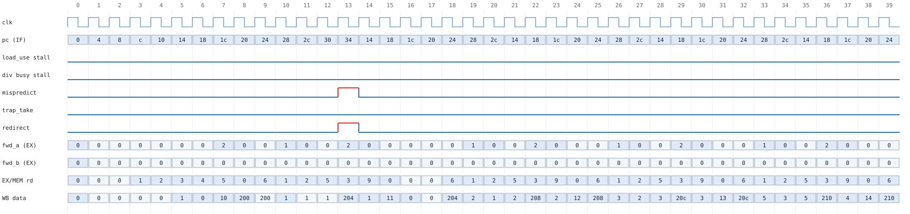

# 5-Stage Pipelined RISC-V Processor (RV32IMA + Zicsr + U-mode + PMP, Verilog)

[](https://github.com/Prathik28/rv32i-pipelined-cpu/actions/workflows/publish.yml)

A verified 5-stage pipelined **RISC-V** core (IF → ID → EX → MEM → WB) that handles every class of
pipeline hazard, with a branch predictor, multiplier/divider, atomics, machine and user privilege
levels, memory protection, precise exceptions, three interrupt sources, memory wait states and
hardware-handled misaligned accesses. (RISC-V rather than MIPS, but the pipeline is the classic
MIPS-style one.)

* **ISA:** RV32I + **M** + **A** + **Zicsr** + **Zifencei**, M-mode and U-mode, 4-entry **PMP**; no compressed instructions
* **Verified** against an independent Python golden model (registers, memory, exit code, console)
  with 17 directed programs, 2 self-checking interrupt tests and 300 random hazard-dense programs,
  and by 36 mutation tests
* **Synthesises** with Yosys for Xilinx 7-series; open-source place-and-route (ECP5) runs in CI; FPGA top level included

## Hazard handling

| Hazard | Cause | Solution | File |
|---|---|---|---|
| **Data (RAW)** | consumer needs a result still in the pipe | forwarding EX/MEM→EX and MEM/WB→EX for both ALU operands, branch compare, store data, CSR operand | `forwarding_unit.v` |
| Data (RAW, 3 apart) | write and read in the same cycle | register file write-through bypass | `regfile.v` |
| **Load-use** | load / LR / SC / AMO data is ready only after MEM | 1-cycle stall, then forward from WB | `hazard_unit.v` |
| **Control** | branch / JAL / JALR resolve in EX | **BTB + 2-bit counters** predict in IF; a misprediction flushes IF/ID + ID/EX (2-cycle penalty); `FENCE.I` flushes the front end | `branch_predictor.v`, `riscv_core.v` |
| **Structural** | IF and MEM both need memory | Harvard architecture (separate instruction / data memories) | `imem.v`, `dmem.v` |
| Structural | register file read + write | write-through regfile | `regfile.v` |
| Structural | iterative divider is not pipelined | front end stalls while it is busy, bubbles enter MEM; operands are latched so forwarding sources may move on | `div_unit.v` |
| **Structural** | **memory wait states, misaligned accesses, atomic read-modify-write take >1 bus cycle** | the whole pipeline freezes in place (`mem_hold`) until the last transaction is accepted; MEM/WB keeps its instruction so forwarding sources survive the freeze | `riscv_core.v` |
| **Exceptions** | fetch/load/store access fault, illegal instruction, ECALL (U/M), EBREAK, misaligned jump target / MMIO access / atomic, machine software / timer / external interrupts | taken **precisely in EX**: the instruction never commits, younger ones are flushed, older ones finish | `riscv_core.v`, `csr_file.v` |
| WAW / WAR | — | impossible: in-order, write-back in the last stage; writes to `x0` are ignored | — |

## What the pipeline does (generated from the RTL)

`make diagram` runs `docs/hazard_demo.s` on the RTL and draws what is in each stage every cycle:
forwarding badges (blue), load-use and divider stalls (orange), flushes (red). Runs of identical
cycles (the 32-cycle divide) are collapsed.


`make wave` renders hazard-unit signals straight from the simulation's VCD (GTKWave works too):



## Instruction set and platform

* **RV32I** (all), **M**: `mul mulh mulhsu mulhu div divu rem remu`, **A**: `lr.w sc.w amoswap/add/xor/and/or/min/max/minu/maxu.w`, **Zicsr**, `mret`, `ecall`, `ebreak`, `wfi`/`fence` as NOPs, `fence.i`
* **Multiplier:** single cycle (maps to DSP). **Divider:** iterative restoring, 32 cycles; divide-by-zero and `INT_MIN / -1` per spec
* **Privilege:** M-mode and U-mode (`mstatus.MPP`, `mret` to U, ECALL from U = cause 8, U-mode CSR/`mret` restrictions, `mcounteren` gates user access to `cycle/time/instret`)
* **PMP:** 4 entries (`pmpcfg0`, `pmpaddr0-3`), OFF/TOR/NA4/NAPOT, lock bit (locked entries bind M-mode and ignore writes), partial-match = fault; applied to fetch, loads, stores and atomics
* **CSRs:** `mstatus misa mie mip mtvec(direct/vectored) mcounteren mscratch mepc mcause mtval mcycle[h] minstret[h]`, read-only `cycle[h] time[h] instret[h]`, PMP registers, `mhartid`
* **Traps:** instruction / load / store **access fault** (outside the address map or denied by PMP), illegal instruction (also bad CSR, write to a read-only CSR, privilege violation, compressed encodings), breakpoint, ECALL, taken-jump-target misaligned, misaligned MMIO access, misaligned atomic
* **Interrupts:** machine **software** (`MSIP`), **timer** (64-bit `mtime` ≥ `mtimecmp`) and **external** (pin or `EXTIRQ` register); priority external > software > timer; vectored mode jumps to `base + 4*cause`
* **Misaligned loads/stores** in RAM are handled **in hardware** (split into two bus transactions); only MMIO and atomics trap (a legal choice)
* **Memory wait states:** the data bus has a ready handshake; a slow RAM with programmable wait states exercises it
* **Self-modifying code:** instruction RAM is also visible on the data bus; `fence.i` flushes the pipeline

| Address | Region / register | Access |
|---|---|---|
| `0x0000_0000`–`0x0000_0FFF` | data RAM (4 KiB) | RW |
| `0x2000_0000`–`0x2000_0FFF` | slow RAM (4 KiB, `WAITCFG` extra wait cycles) | RW |
| `0x3000_0000`–`0x3000_0FFF` | instruction RAM via the data bus (use `fence.i` after writing) | RW |
| `0x1000_0000` | HALT — a write ends the program, value = exit code | W |
| `0x1000_0004` | PUTCHAR — prints a character in simulation | W |
| `0x1000_0008` / `0x1000_0020` | MTIMECMP low / high (reset all-ones = no timer interrupt) | RW |
| `0x1000_000C` / `0x1000_0024` | MTIME low / high (free-running cycle counter) | R |
| `0x1000_0010` | LEDS (16-bit GPIO) | RW |
| `0x1000_0014` | WAITCFG — extra wait cycles of the slow RAM (0–15) | RW |
| `0x1000_0018` | MSIP — bit 0 = software interrupt pending | RW |
| `0x1000_001C` | EXTIRQ — bit 0 = software-driven external interrupt line | RW |

Anything outside these regions raises an access fault. Instruction memory is 4 KiB, PC starts at 0,
and the program is loaded from a hex file.

## Results

Output of `make test` (cycles are measured in the RTL; CPI includes startup/drain):

```
test                  result  cycles instret   CPI ld-use  div flush branch mispred traps
01_raw_forwarding     PASS        20      16  1.25      0    0     0      0     0   -    0
02_load_use           PASS        20      13  1.54      3    0     0      0     0   -    0
03_branches           PASS        75      48  1.56      1    0    11     20    11 45%    0
04_jumps              PASS        25      13  1.92      0    0     4      4     4  0%    0
05_memory             PASS        25      20  1.25      1    0     0      0     0   -    0
06_fibonacci          PASS       228     200  1.14     16    0     4     32     4 88%    0
07_bubble_sort        PASS       761     599  1.27     66    0    46    143    46 68%    0
08_shifts_alu         PASS        25      21  1.19      0    0     0      0     0   -    0
09_mixed_hazard_chain PASS        24      13  1.85      1    0     3      4     3 25%    0
10_muldiv             PASS       309      34  9.09      1  270     0      1     0 100%    0
11_csr_traps          PASS       142      98  1.45      0    0    15      1     1  0%    7
12_branch_predict     PASS       873     753  1.16      0    0    58    286    58 80%    0
13_misaligned_mem     PASS        84      54  1.56      3    0     4      0     0   -    2
14_atomics            PASS       108      70  1.54      2    0     8      0     0   -    4
15_umode_pmp          PASS       368     271  1.36      0    0    39     34     9 74%   15
16_fencei_selfmod     PASS        93      69  1.35      0    0    10      6     3 50%    0
17_wait_states        PASS       321     119  2.70     11   66     5     17     5 71%    0
sc_irq_soft_ext       PASS       359     306  1.17      1    0    21     79     9 89%    6
sc_irq_timer          PASS       395      65  6.08      5  297    10      8     2 75%    4
random programs: 300/300 passed
ALL TESTS PASSED
```

(`ld-use` / `div` = stall cycles, `flush` = pipeline redirects, the percentage after `mispred` is
prediction accuracy over committed control-flow instructions. CPI of `10_muldiv` is high on purpose:
it is almost all divides at ~34 cycles each; `17_wait_states` is slow because the slow RAM adds 3 wait
cycles per access.)

### Synthesis (Yosys, Xilinx 7-series, `make synth`)

| LUTs | Flip-flops | DSP48E1 | Distributed RAM |
|---|---|---|---|
| 4738 | 1351 | 4 | register file + instruction RAM (two read ports) + two 4 KiB data RAMs |

Yosys only, no place-and-route. The dual-ported instruction RAM and the extra slow RAM map to
LUT-RAM here (an earlier single-port version used block RAM); a production design would map them to
true dual-port block RAM.

### Place and route (open-source, Lattice ECP5, `sw/ecp5_timing.sh`)

The CI `timing` job runs Yosys + nextpnr for an ECP5 LFE5U-85F (speed grade 6; the 25F is too small now that the memories live in logic cells) with no local install;
its result is in the job summary and the `ecp5-timing` artifact of every run.

| LUT4 (TRELLIS_COMB) | Flip-flops | Block RAM | Multipliers (MULT18X18D) | Estimated Fmax |
|---|---|---|---|---|
| 27688 / 83640 (33%) | 1349 | 0 (memories are built from LUTs) | 4 / 156 | **≈ 27 MHz** (passes a 25 MHz target) |

The earlier, simpler core (no PMP, atomics, wait states or misaligned handling) reached ≈ 40 MHz on
the smaller ECP5-25F. The new core is slower mainly because its memories have asynchronous reads and
live in logic cells, and because the address checks (map, PMP, alignment) now sit in front of the
memory stage. Registering the memory read (true block RAM) would trade one more pipeline stage for
a much higher clock; that is not done here.

This is a single-seed estimate for the ECP5 family against a 25 MHz target (nextpnr stops optimising
once the target is met, so the true limit may be somewhat higher). It says nothing exact about the
Basys 3's Artix-7. The example top level (`fpga/fpga_top.v`, `fpga/basys3.xdc`) divides the Basys 3's
100 MHz clock by 4 and shows a binary counter (`fpga/blink.s`) on the LEDs. It has been simulated but
**never run on hardware**.

## How it is verified

* `sw/iss.py` is an independent, non-pipelined golden model (it knows nothing about the pipeline).
  `make test` runs each program on both and compares all 32 registers, fast and slow RAM, the exit
  code and the console output.
* `sw/gen_random.py` produces random programs with dense RAW / load-use hazards, loops, forward
  branches, M-extension operations (including divide-by-zero and overflow), CSR accesses, atomics
  (LR/SC and AMOs, misaligned and to invalid addresses), accesses to fast RAM, slow RAM with random
  wait states, instruction RAM and MMIO, misaligned and out-of-map accesses, `fence.i`, illegal
  instructions and ECALL/EBREAK. A handler folds `mcause`/`mtval` into a register so trap behaviour
  is compared too.
* Interrupt timing depends on the pipeline, so `sc_irq_timer.s` and `sc_irq_soft_ext.s` are
  **self-checking** (exit code 0 = pass): they check interrupt ordering and priority, vectored
  dispatch, ECALL staying at the base address in vectored mode, and the 64-bit counters.
* `tests/15_umode_pmp.s` drops to U-mode and checks locked / NA4 / NAPOT PMP entries, access faults,
  `mcounteren`, ECALL from U-mode and instruction-fetch faults; `16_fencei_selfmod.s` patches code
  through the data port; `17_wait_states.s` freezes the pipeline with a slow RAM.
* `make mutate` breaks the design **36 ways** (no forwarding, no stall, no flush, wrong divider sign,
  traps committing, broken BTB, wait states ignored, PC not held, SC always succeeding, PMP and
  privilege checks removed, `fence.i` not flushing, vectored mode ignored, …); every mutant must make
  the tests fail. The branch predictor never changes program results, so its tests assert
  **performance limits** (`# PERF mispred<=60`). One further mutant (removing the divider's freeze
  input) is *equivalent*: a memory wait can never overlap an active divide, so it is documented
  instead of tested.

## Usage

Requires Icarus Verilog (`brew install icarus-verilog`) and Python 3; Yosys for `make synth`.

```
make test                            # directed + 300 random programs vs the golden model
make run T=tests/07_bubble_sort.s    # run one program
make wave T=docs/hazard_demo.s       # build/wave.vcd + docs/waveform.svg
make diagram                         # docs/pipeline_hazards.svg
make synth                           # Yosys synthesis report
make mutate                          # mutation test (ONLY=regex runs a subset)
```

Write your own programs in `tests/` (assembler: `sw/asm.py`; pseudo-ops `li la mv j ret beqz bnez
ble bgt csrr csrw …`, atomics `lr.w sc.w amo*.w[.aq/.rl]`, `fence.i`, `.word`, and `halt` to end the
program). Note: `+hex=` paths cannot contain spaces.

## Layout

```
rtl/   riscv_core riscv_soc alu regfile imm_gen control_unit forwarding_unit hazard_unit
       branch_predictor mul_unit div_unit csr_file pmp_check imem dmem
tb/    tb_riscv.v        runs +hex=prog.hex; +vcd waveform, +trace pipeline trace
sw/    asm.py iss.py gen_random.py run_tests.py mutation_check.sh synth.sh ecp5_timing.sh
       vcd2svg.py pipeline_diagram.py
tests/ directed programs (NN_*.s compared with the ISS, sc_*.s self-checking)
fpga/  fpga_top.v timing_top.v basys3.xdc blink.s
docs/  hazard_demo.s and the generated SVGs
```

## Limitations

* No S-mode, virtual memory, `mstatus.MPRV`, or `wfi` sleep; PMP has 4 entries and no execute-only edge cases beyond the basic rules
* No C (compressed), F/D extensions; A extension is single-hart (no `.d`, reservation cleared only by SC and traps)
* Misaligned accesses to MMIO and misaligned atomics trap (legal); misaligned RAM accesses are handled in hardware
* Wait states apply to the data bus only; there are no caches; instruction fetch is single-cycle
* Interrupt sources: software, timer and external only (no PLIC/CLINT register layout)
* Not run on real hardware; the only timing figure is the ECP5 place-and-route estimate above
* This is a RISC-V design. A MIPS32 variant is not included.
