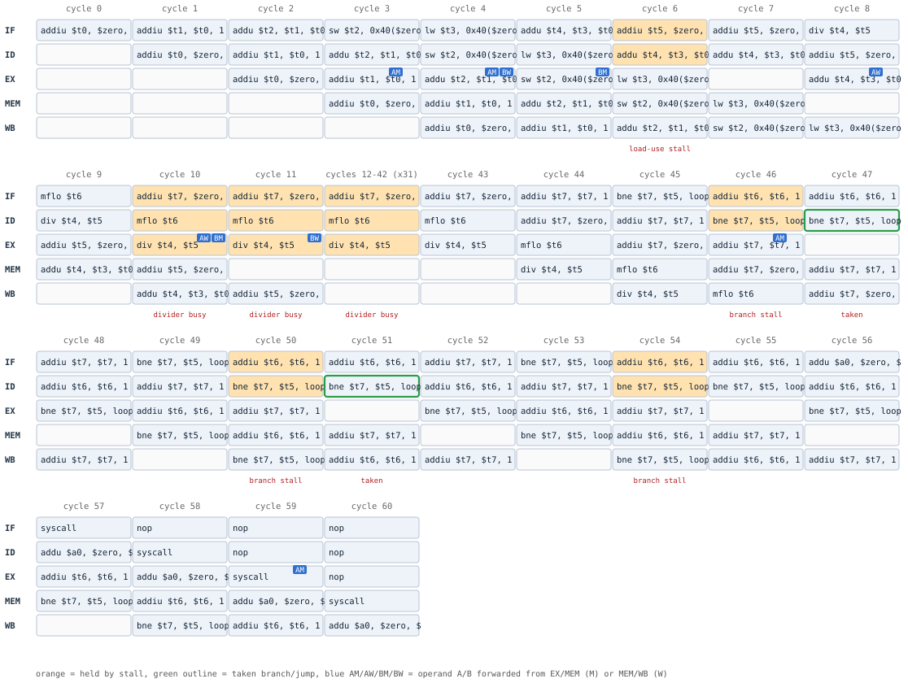

# 5-Stage Pipelined MIPS32 Processor (Verilog)

A second processor in this repository: a verified 5-stage pipelined **MIPS32** integer core
(IF → ID → EX → MEM → WB) with the classic MIPS **branch delay slot**. It reuses the verification
approach of the [RISC-V core](../README.md): an independent Python golden model, directed and
random programs compared register-by-register, and mutation tests.

> MIPS and RISC-V are different instruction sets. The two cores share pipeline ideas (forwarding,
> load-use stalls, an iterative divider) but not instruction encodings.

## Hazard handling

| Hazard | Cause | Solution |
|---|---|---|
| **Data (RAW)** | consumer needs a result still in the pipe | forwarding EX/MEM→EX and MEM/WB→EX; register-file write-through (WB→ID) |
| **Load-use** | load data is ready after MEM | 1-cycle stall, then forward from WB |
| **Control** | branches/jumps resolve in **ID** | the **delay slot** (the instruction after a branch always executes) hides the branch penalty: **no flush, no prediction, 0-cycle penalty** |
| **Control + data** | a branch/jump needs its operands in ID, earlier than the ALU does | ALU result in MEM → forwarded into the ID comparator; producer in EX → 1 stall; load in MEM → 1 more stall (**2 in total for load → branch**) |
| **Structural** | `DIV`/`DIVU` are iterative (32 cycles) | front end stalls while the divider is busy, bubbles enter MEM |
| **Structural** | `HI`/`LO` written by `MULT`/`DIV`, read by `MFHI`/`MFLO` | written and read in EX in program order, so no extra interlock is needed |
| **Structural** | IF and MEM both need memory | Harvard architecture (separate instruction / data memories) |
| WAW / WAR | — | impossible: in-order, write-back in the last stage; writes to `$0` are ignored |

Differences from the RISC-V core: branches resolve one stage earlier (ID instead of EX) and use the
delay slot instead of a branch predictor; `HI`/`LO` replace multiply/divide results in ordinary
registers; there are no CSRs, traps or interrupts.

## What the pipeline does (generated from the RTL)

`make diagram` runs `docs/hazard_demo.s` on the RTL: forwarding badges (blue), stalls (orange), a
taken branch (green outline: the delay slot is already being fetched). Runs of identical cycles
(the 32-cycle divide) are collapsed.



## Instruction set

`add addu sub subu and or xor nor slt sltu`, `sll srl sra sllv srlv srav`, `addi addiu slti sltiu andi ori xori lui`,
`lb lbu lh lhu lw sb sh sw`, `beq bne blez bgtz bltz bgez bltzal bgezal`, `j jal jr jalr`,
`mult multu div divu mfhi mflo mthi mtlo mul`, `syscall` (ends the program, `$a0` = exit code).
Pseudo-ops in the assembler: `nop move li la b beqz bnez blt bge bgt ble not negu halt`.

Memory map: 4 KiB data RAM at `0`; a store to `0xFFFF0004` prints a character in simulation. The
program (instruction memory, 4 KiB) starts at address 0.

## Results

Output of `make test` (cycles measured in the RTL; CPI includes startup/drain):

```
test                  result  cycles instret   CPI ld-use br-stall  div  taken
01_raw_forwarding     PASS        22      18  1.22      0        0    0      0
02_load_use           PASS        20      13  1.54      3        0    0      0
03_branches           PASS        44      40  1.10      0        0    0     10
04_jumps              PASS        32      26  1.23      0        2    0      8
05_memory             PASS        25      20  1.25      1        0    0      0
06_fibonacci          PASS       220     200  1.10      0       16    0     30
07_bubble_sort        PASS       953     740  1.29     66      143    0     98
08_alu_shifts         PASS        30      26  1.15      0        0    0      0
09_hilo_muldiv        PASS       183      44  4.16      0        1  134      1
10_branch_hazards     PASS        56      45  1.24      1        6    0      9
11_console_exit       PASS        12       8  1.50      0        0    0      0
random programs: 200/200 passed
ALL TESTS PASSED
```

(`br-stall` = cycles a branch/jump waited for its operand. `09_hilo_muldiv` is slow on purpose: it is
mostly divides at ~34 cycles each.)

## How it is verified

* `sw/mips_iss.py` is an independent, non-pipelined golden model with delay-slot semantics.
  `make test` compares all 32 registers, `HI`/`LO`, data memory, exit code and console output.
* `sw/gen_random.py` makes random programs with dense RAW / load-use / branch-operand hazards,
  forward branches and jumps (every one with a delay slot), counted loops, `jr`/`jalr` through
  just-computed addresses, multiply/divide with `HI`/`LO` traffic, divide-by-zero and byte/half/word
  memory accesses. Over 60 sample programs: ~2900 branch-operand stalls, ~4700 divider stalls,
  ~3100 taken branches/jumps.
* `make mutate` breaks the design **22 ways** (no forwarding, no load-use stall, branches ignoring a
  producer in EX or a load in MEM, no ID forwarding, delay slot skipped, `JAL` linking PC+4, divider
  not stalling, wrong `MULT` signedness, `SRA` logical, `BLTZAL` not linking, …); every mutant must
  make the tests fail.

## Usage

Requires Icarus Verilog and Python 3.

```
make test                          # directed + 200 random programs vs the golden model
make run T=tests/07_bubble_sort.s  # run one program
make diagram                       # docs/pipeline_hazards.svg
make mutate                        # mutation test (ONLY=regex runs a subset)
```

Programs are written with **explicit delay slots** (the assembler never reorders): put a useful
instruction or a `nop` after every branch and jump. Note: `+hex=` paths cannot contain spaces.

## Limitations

* No CP0 / exceptions / interrupts: `ADD`/`ADDI`/`SUB` behave like their unsigned forms (no overflow trap),
  `SYSCALL` just ends the simulation, misaligned loads/stores are undefined
* Not implemented: `LWL/LWR/SWL/SWR`, branch-likely, `MOVZ/MOVN`, `CLZ`, coprocessors, floating point
* A branch or jump inside another branch's delay slot is undefined (as in MIPS)
* Divide by zero is implementation-defined here (`LO = 0xFFFFFFFF`, `HI` = dividend); `INT_MIN / -1` gives `INT_MIN`
* Simulation only: no synthesis or FPGA flow for this core, and not run on hardware
